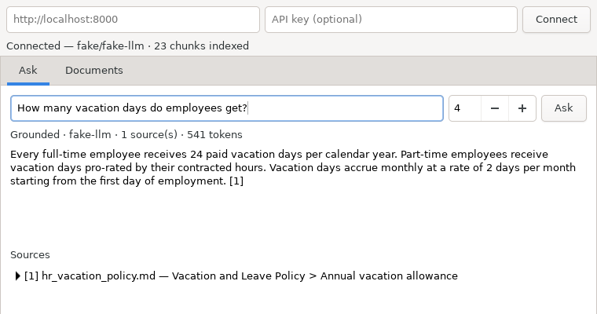
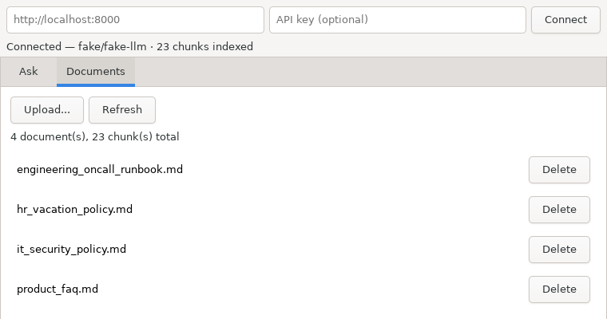

# Knowledge Copilot Desktop

A native GTKmm4/C++ desktop client for [Knowledge Copilot](https://github.com/Kotoliji/knowledge-copilot),
a document-Q&A API (FastAPI + Qdrant). Ask questions about your documents and
see the cited source passages, upload and manage documents — all from a
native Linux desktop app instead of a browser tab.

## Screenshots

Asking a question — grounded answer with an expandable, cited source:



Managing documents — upload, list, delete:



## Why a native client for an existing API

Knowledge Copilot already has a web UI. This project exists to practice
native C++/GTK desktop development against a real, working REST API rather
than a toy backend — the kind of "frontend for an existing service" work a
desktop or embedded role actually involves, instead of inventing both ends
of the wire format.

## Architecture

```
src/api/        HTTP client (libcurl) + JSON (de)serialization (nlohmann/json).
                No GTK dependency — pure logic, unit tested directly.
src/ui/         GTKmm4 views. Network calls run on a worker thread and report
                back to the UI thread via Glib::Dispatcher, so a slow request
                never freezes the window.
tests/          Catch2 tests for response parsing and error handling —
                run without a live server or any GTK code in the build.
```

The split matters: `kc_api` is a plain static library with no GTK dependency,
so the request/response logic is tested the same way you'd test any C++
library — fast, no display required, no network mocking needed since the
parsing functions take JSON text directly.

## Requirements

- A running Knowledge Copilot instance (see
  [its README](https://github.com/Kotoliji/knowledge-copilot) — it has a
  fully offline demo mode with no API keys needed)
- CMake 3.22+, a C++20 compiler
- GTKmm 4, libcurl, nlohmann-json, Catch2 (dev headers)

On Ubuntu/Debian:

```bash
sudo apt-get install build-essential cmake pkg-config \
  libgtkmm-4.0-dev libcurl4-openssl-dev nlohmann-json3-dev catch2
```

Or use the provided `Dockerfile.dev` for a ready-made build environment.

## Build & run

```bash
cmake -S . -B build -DCMAKE_BUILD_TYPE=Release
cmake --build build -j
./build/kc_desktop
```

On first launch, enter your Knowledge Copilot instance's URL (default
`http://localhost:8000`) and an API key if the instance requires one, then
click Connect.

## Testing

```bash
cmake --build build
./build/kc_tests
```

Tests cover response parsing (`/health`, `/ask`, `/agent`, `/documents`,
`/ingest`) and error handling, including FastAPI/Pydantic's validation-error
shape (`detail` as a list of objects, not a plain string) — a detail that's
easy to get wrong if you only test the happy path.

## Notes

- Every network call is blocking and runs off the UI thread explicitly
  (`src/ui/Async.h`) — GTK's main loop is single-threaded, and this is the
  supported way to keep it responsive.
- The client distinguishes a request that *reached* the server and got an
  error response (`ApiError`, with the API's own message) from one that
  *never reached it* (`NetworkError`) — useful for telling "wrong API key"
  apart from "server is down" in the UI.
